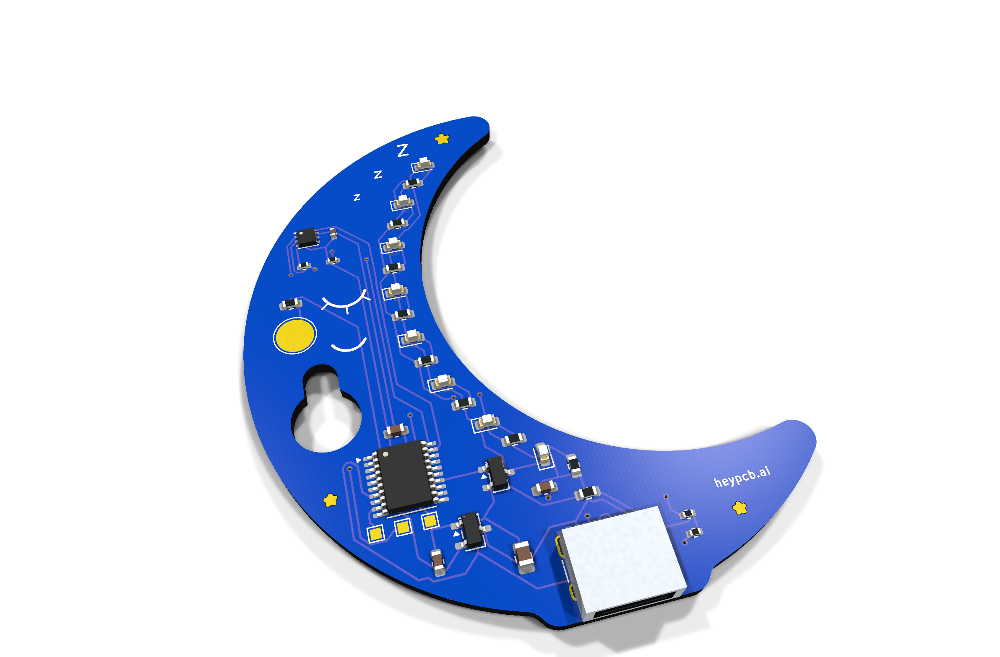
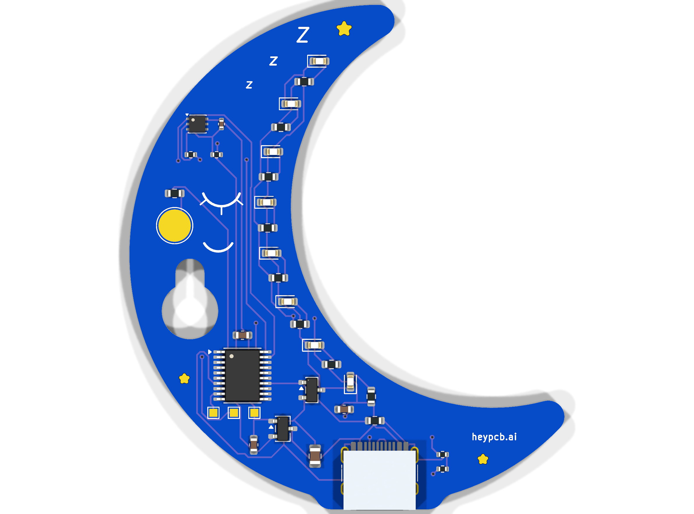
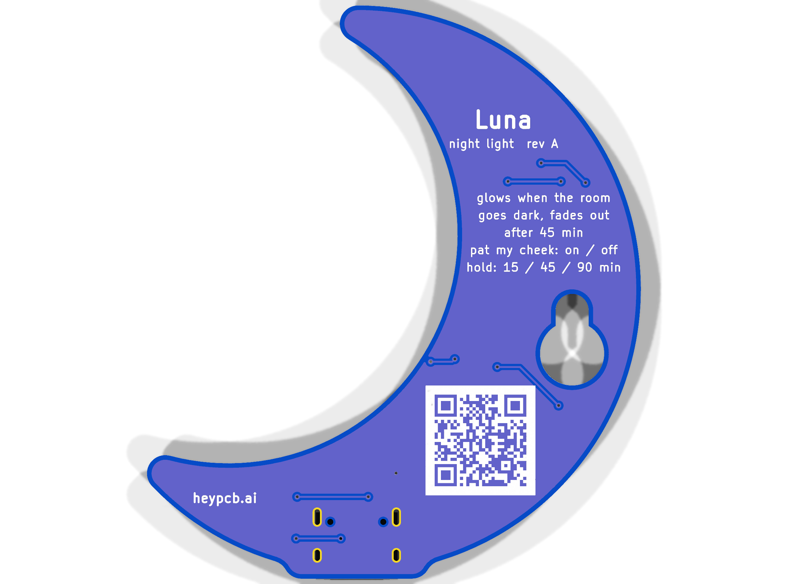

# Luna, the night-light moon

**A sleepy moon that turns on at dusk and tucks itself in after you fall asleep.**

Luna is a crescent-moon night light on USB-C. An APDS-9306 ambient light sensor tells a CH32V003 when the room has gone dark; eight orange LEDs along the moon's inner curve then fade up to a candle-coloured glow, and fade out again after a 15, 45 or 90 minute sleep timer. It stays off until the room sees daylight. Pat its gold cheek to switch it by hand; hang it on a nail by its keyhole.

| Layers | Size | Parts | Nets | Connections routed | Vias | ERC errors | DRC errors / unconnected / parity | BOM @100 |
|---|---|---|---|---|---|---|---|---|
| 2 | 54.0 x 62.7 mm | 32 (+4 pads) | 22 | 67 -> 0 open | 13 | 0 | 0 / 0 / 0 | $1.43 |

**Not fabricated, assembled or powered yet.** Every number on this page is measured by KiCad 10.0.6 on
the files in this repository ([`report.json`](report.json), [`measured.json`](measured.json)) or read
from the live JLC/LCSC catalogue ([`bom_cost.json`](bom_cost.json)).

| | |
|---|---|
| Spec, power budget, BOM | [`SPEC.md`](SPEC.md) |
| Store copy | [`STORE_COPY.md`](STORE_COPY.md) |
| KiCad 10 project | [`kicad/`](kicad/) |
| Gerbers, drill, BOM, CPL, STEP, schematic PDF | [`fab/`](fab/) |
| Firmware | [`firmware/`](firmware/) |
| Renders | [front](media/top.png), [back](media/bottom.png), [hero](media/hero.png), [Circuit World thumbnail](media/circuit-world.png) |
| Brief and generator | [`design/`](design/) |

 

## What's on it

- **Glow:** 8 XL-1608UOC orange (605 nm) LEDs, each with its own 220 Ohm from 5 V, switched together by an AO3400A on TIM1 CH4 at 1 kHz.
- **Light sensor:** Broadcom APDS-9306-065 at I2C 0x52, 3.3 V, bit-banged I2C with 10k pull-ups.
- **MCU:** CH32V003F4P6 at 3.3 V from an XC6206 LDO (JLC Basic).
- **Touch:** a 4 mm ENIG cheek pad through 1 kOhm, read by ch32fun's ADC touch.
- **Mounting:** a keyhole cutout near the centre of mass; USB-C out of the bottom.
- **Power:** USB-C, about 0.2 W while glowing (SPEC.md).

## Finish

Blue solder mask, White silkscreen, ENIG copper finish, 1.6 mm FR4, top-side SMT assembly (J1: an SMD part whose shell legs go through plated holes, soldered on the same SMT line).
The gold art is bare copper under a mask opening (ENIG), drawn with its own keep-out so no track runs
under it. The QR code on the back opens [https://heypcb.ai/world/b/e2974968006f](https://heypcb.ai/world/b/e2974968006f).

## How it was made

Designed with the HeyPCB method on KiCad 10.0.6, headless, by the `heypcb-kicad` pipeline: a written
brief composed from reusable circuit blocks, every pin from KiCad's own symbol library, every part bound
to an LCSC number from a dated catalogue read, then ERC, a netlist round trip, locked placement,
Freerouting 2.4.1, pours, silkscreen and board art, DRC with schematic parity, DFM and a fab gate,
each stage gated by a measurement. `design/make_brief.py` regenerates the brief (outline, part
locks and art) from code.

Part of the [heypcb.ai merch collection](https://github.com/HeyPCB/merch).

## License

Hardware: [CERN-OHL-S v2](LICENSE). Firmware: MIT (see [`firmware/LICENSE`](firmware/LICENSE)). KiCad's symbol, footprint and 3D
libraries used in the design are CC-BY-SA 4.0 with the KiCad library exception.
